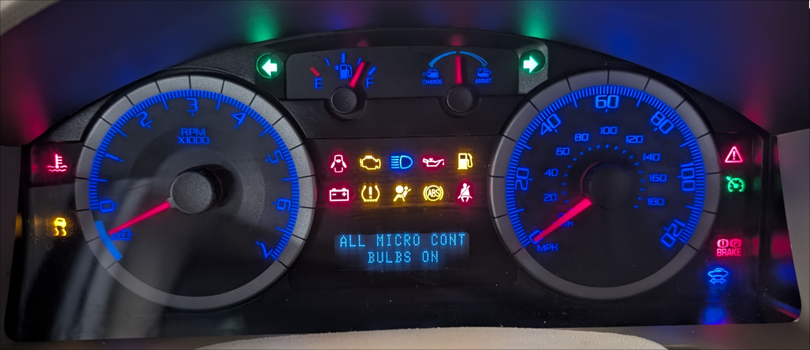
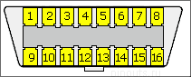
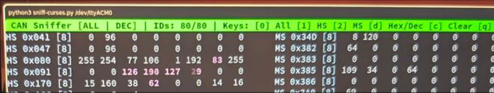

# ford-escape-mk2-can-id

This repository documents my CANbus reverse engineering efforts attempted on a Ford Escape 2009 Limited Hybrid. 

> [!WARNING]
> Please be careful when messing with your vehicle! It is always a good idea to experiment on test hardware, make sure that you can recover from a module failure, and in general that you understand what you are doing.  
**If this sets off an airbag, bricks an ECU, or blows up your car, that's entirely on you. Use at your own risk.**

---

## Motivation

As someone working in IT, I have always been interested in how car ECUs work; add my need for customization, and you already see where I am going. I bought a VCM2 programmer and FORScan, and did some module parameter programming on my own. Then I got into the world of CAN frames by implementing the FoDiMoCo project on my Escape. While I was experimenting with Arduinos back then, my first car-related project was replacing the 8-color ambient floor lighting with a true 16M RGB setup (which was really just about replacing the control module itself).

Recently, my wife got herself a 2025 Ford Puma, and of course I immediately FORScanned the heck out of it. There are good and bad things about new cars, and not going to lie: I considered for a long time whether I should get a Kuga (the successor to the Escape - at least on paper... it has nothing to do with the 2nd Gen Escape platform), but in the end I decided to keep my current car as long as reasonable. I did just pass 400,000 km, and living in the EU means not many spare parts for me. While a lot of people out there dislike "tablet/screen-only cars", I don't: I hate when they remove physical buttons (like climate control, instrument cluster backlight, etc.), but I actually like the screens themselves. So it occurred to me that I could maybe build a modern instrument cluster for my old Escape. Whether it works or not remains to be seen, but reverse engineering CAN messages is the first step, and I decided to share my findings with others who might be interested.

From a CAN bus perspective, the Escape follows what other Ford vehicles have: an MS-CAN line operating at 125 kbps for non-critical modules (like climate control), and an HS-CAN line running at 500 kbps where the critical stuff lives (like powertrain and chassis modules). Unlike in newer cars where the two CAN lines are bridged via a dedicated Gateway Module, on this platform it is the Instrument Cluster that does the bridging. This made it my primary target, along with the fact that it is the exact unit I am looking to "replace." So I built a small hardware setup to tap into both CAN buses, monitor changes, and try to decode what means what.

It would have been better to grab the firmware (the so-called strategy) and reverse engineer that directly, but I was unable to find one. In theory, I could read it with a programmer attached to the debug headers on the cluster's PCB, but I don't want to risk bricking my working cluster with methods I am not entirely familiar with (and unfortunately, my testbench module is not from a Hybrid, so I can't just pull the calibration from that).

## Vehicle parameters

- **Make and model**: Ford Escape Hybrid
- **Year**: 2009 (2nd Gen)
- **Trim**: Limited
- **Engine**: 2.5L Atkinson-cycle I-4
- **Transmission**: eCVT Automatic
- **Drivetrain**: 4WD
- **Climate Control**: Dual-Zone Electronic Automatic
- **Infotainment**: originally a no-screen SYNC 6-disc radio -> replaced with aftermarked Topway head unit
- **Cruise Control**: equipped

- **Instrument Cluster strategy version**: `9M6T-10C026-BC`
- **Instrument Cluster calibration version**: `9M6T-10849-CC`

## CAN frames

### Status Legend

| Status | Description |
|---|---|
| Verified | Confirmed and functional mapping |
| Likely | Almost certain, but requires final bench verification |
| Math ? | The Frame ID and byte is mapped, but the calculation is unknown |
| Uncertain | Just a hypothesis, low confidence |
| TBD | Planned item, not yet or unsuccessfully investigated |
| Not found | Quite certain that the metric is not transmitted |

### Powertrain

| Metric | bus | ID | relevant byte(s) | status | calculation | notes |
|---|---|---|---|---|---|---|
| **Engine RPM** | HS | `0x180` | 0-1 | Verified | `([0] * 256 + [1]) / 4` | - |
| **Vehicle Speed** | HS | `0x425` | 0-1 | Verified | `([0] * 256 + [1]) / 100` | - |
| **Coolant Temp** | MS | `0x423` | 4 | Verified | `[4] - 40` (°C) | When no ignition: value is unset, can be any random number, OK after ignition |
| **Coolant Temp Critical LED**  | - | - | - | TBD | - | Likely derived from `HS 423` byte 4 |
| **Gear Position** | HS | `0x510` | 0 | Verified | `P=0x46`, `R=0x3C`, `N=0x32`, `D=0x28`, `L=0x14` | Preferred over noisy `0x500` (which has `0xFF` randomly) |
| **Odometer** | HS | `0x470` | 5 | Math ? | ? | Rollcount byte; 1.0 km -> ~20 rollover |
| **Cruise Control ON LED**  | - | - | - | TBD | - | Likely on HS-CAN (PCM) |
| **MIL (Check Engine)**  | - | - | - | TBD | - | - |
| **Service (Wrench) LED**  | - | - | - | TBD | - | I have desoldered this LED, as it is constantly on with a false positive |
| **Oil Pressure Low LED**  | - | - | - | Not found | - | Directly wired to the Instrument Cluster :( |
| **4x4 Active LED** | - | - | - | TBD | - | Not lighting up on my IC, fauly LED? |

### Electrical

| Metric | bus | ID | relevant byte(s) | status | calculation | notes |
|---|---|---|---|---|---|---|
| **Charge / Assist Gauge** | HS | `0x300` | 1-2 / 3 | Uncertain | ? | - |
| **12V Battery Voltage** | - | - | - | TBD | - | - |
| **Ready LED**  | - | - | - | TBD | - | Hybrid ready indicator status, normally green :D |
| **STOP SAFELY NOW (Red Triangle LED)**  | - | - | - | TBD | - | - |
| **12V Battery LED**  | - | - | - | TBD | - | Directly measured by the Instrument Cluster, but could be derived from the voltage itself |

### Fuel

| Metric | bus | ID | relevant byte(s) | status | calculation | notes |
|---|---|---|---|---|---|---|
| **Fuel Level (Filtered)** | HS | `0x430` | 0 | Verified | `0-255` mapped to `0-100%` | Filtered output (by IC) |
| **Fuel Level (Raw)** | HS | `0x430` | 1 | Verified | `0-255` mapped to `0-100%` | Raw sensor reading |
| **Distance to Empty** | - | - | - | TBD | - | Could be internally calculated in IC |
| **Low Fuel LED**  | - | - | - | TBD | - | Likely derived from `HS 0x430` byte 0 |

### Safety

| Metric | bus | ID | relevant byte(s) | status | calculation | notes |
|---|---|---|---|---|---|---|
| **Airbag LED**  | - | - | - | TBD | - | - |
| **ABS Fault LED**  | - | - | - | TBD | - | - |
| **Seatbelt Reminder LED**  | HS | `0x350` | 0 | Verified | Low hex digit: On = `0xX4`, Off = `0xX0` | Seatbelt status on `0x340`, driver: byte 1 = `00` when using seatbelt, `02` when not; passenger: byte 3 `40` when using seatbelt, `00` when not. Only active when IC BeltMinder is ON, AND only 40-60 secs after ignition.|
| **TCS Indicator**  | HS | `0x417` | 1 | Verified | High hex digit: TCS On = `0x0X`, TCS Off = `0x4X` (=LED on) | TCS intervene (blinking LED) is TBD |

### Lighting

| Metric | bus | ID | relevant byte(s) | status | calculation | notes |
|---|---|---|---|---|---|---|
| **Light Switch Position** | MS | `0x3C3` | 1 | Verified | Off: `0x00`; Parking lights: `0x01`; Auto (Day): `0x02`; Auto (Night): `0x3B`; Fixed On: `0x39` | when highbeam is on the the following change -> Auto (Night): `0x03`; Fixed On: `0x01` ; When no ignition: auto shows day even in dark |
| **Low Beam Status** | MS | `0x3C3` | 1 | Verified | Manual On: `0x39`; Auto On: `0x3B`; Off: other | could also be just the high hex digit; off when highbeam is on (which is technically true for a H13 bulb) |
| **High Beam Status**  | MS | `0x3C3` | 0 | Verified | Active: `0x02`; Off: `0x00` | When no ignition: if toggled, only shows `0x02` when lightswitch is off or auto(day) |
| **Turn Signals**   | MS | `0x383` | 0-1 | Verified | **Left:** Byte 0 toggles On (`0x4E`) / Off (`0x0A`); **Right:** Bytes 0-1 toggle On (`0x30 0xC0`) / Off (`0x10 0x40`); **Hazards:** Bytes 0-1 toggle On (`0x64 0x80`) / Off (`0x02 0x40`) | - |
| **Front Fog Lights** | MS | `0x3C3` | 2 | Verified | Off: `0x00`; Requested: `0x20` | `0x20` does not mean the lights are on! |
| **Full Interior Lighting** | MS | `0x3C3` | 4 | Verified | High hex digit: On = `0x8X`, Off = `0x0X`, Police / dark car mode (disabled) = `0xCX` | - |
| **Panel Backlight Dimming** | MS | `0x3AB` | 0-1 | Verified | **Byte 0:** Raw PWM (`254` down to `46`); **Byte 1:** Stepped level for IC backlight (`1`-`21`) | Police mode locks to `140, 14` |

### Body and comfort

| Metric | bus | ID | relevant byte(s) | status | calculation | notes |
|---|---|---|---|---|---|---|
| **Key / Ignition State** | MS | `0x3A0` | 0 | Verified | Key Removed: `0x11`; Key Inserted: `0x15`; Acc / Run: `0x44` / `0x45`; Crank / Start: `0x84` | Start is just momentary, reverts to `0x44`/`0x45`; investigate diff between `0x44` and `0x45`, could be that high and low hex means different things! |
| **Door Ajar Status**  | MS | `0x3B1` | 0 | Verified | Bitmask flags: Driver Front: `0x80`; Passenger Front: `0x40`; Left Rear: `0x20`; Right Rear: `0x10`; Trunk / Liftgate: `0x06` | `[D][P][LR][RR][0][T][T][0]` |
| **Central Lock** | MS | `0x385` | 1 | Verified | High hex digit: All locked = `0x1X`, Unlocked = `0x2X` | Didn't test with 2-stage lock mode |
| **Handbrake Switch**  | HS | `0x430` | 6 | Verified | High hex digit: Engaged: `0x2X`; Disengaged: `0x0X` | - |
| **Compass Heading** | MS | `0x3C7` | 0-1 | Verified | Raw 2-byte ASCII (space padded for single char, e.g. `"N "` vs `"NE"`) | Empty ("  ") before ignition |
| **Tire Pressure (TPMS)** | MS | `0x3B5` | 0-3 | Verified | Values directly in PSI: Front Left: `Byte 0`; Front Right: `Byte 1`; Rear Left: `Byte 2`; Rear Right: `Byte 3` | BAR = PSI / 14.5 |
| **Tire Pressure Warning (TPMS) LED**  | MS | `0x3B5` | 0-3 | Likely | Triggers on sensor fault, if any of the bytes are `FD` | Low pressure is derived from MS `0x3B5` |
| **PATS / Immobilizer LED**  | - | - | - | TBD | - | - |

### Climate Control (HVAC)

| Metric | bus | ID | relevant byte(s) | status | calculation | notes |
|---|---|---|---|---|---|---|
| **Driver Setpoint Temp** | MS | `0x3C8` | 0-1,5 | Verified | 0-1 -> ASCII pair: e.g. `"16"` = `0x31 0x36`, `"24"` = `0x32 0x34`, `"32"` = `0x33 0x32` | .5 step: byte 5, bit 3,2 = `10` (`01` on .0) ; "F" when ignition off |
| **Passenger Setpoint Temp** | MS | `0x3C8` | 2-3,5 | Verified | 2-3 -> ASCII pair (same mapping as driver) | .5 step: byte 5, bit 1,0 = `10` (`01` on .0) ; "F" when ignition off, "C" before first dual zone activation |
| **Passenger Dual Zone Active** | MS | `0x3C8` | 7 | Verified | High hex digit: Active = `0xCX`, Off = `0x4X` | - |
| **Outside Temp** | - | - | - | TBD | - | - |
| **Blower Fan Speed** | MS | `0x3C8` | 6 | Verified | Low hex digit: Off=`0xX0`, Auto=`0xX1`, Speed 1=`0xX3`, Speed 2=`0xX5`, Speed 3=`0xX7`, Speed 4=`0xX9`, Speed 5=`0xXB`, Speed 6=`0xXD`, Speed 7=`0xXF` | Auto is for the speed, it is not the AUTO A/C mode |
| **Airflow direction** | - | - | - | TBD | - | - |
| **Heated seat** | - | - | - | TBD | - | - |
| **Air Circulation mode** | - | - | - | TBD | - | - |
| **Temperature Unit** | MS | `0x3C8` | 6 | Verified | High hex digit: °C = `0x1X`, °F = `0x2X` | This changes the temp bytes as well |
| **A/C Clutch Request** | MS | `0x3A1` | 0 | Verified | A/C Requested=`0x80`, Off=`0x00` | Also on HS: `0x180`, Byte 2, High hex digit: A/C Requested = `0x1X`, Off = `0x0X` ; seems more stable on MS |
| **A/C Compressor Active** | MS | `0x3A4` | 0 | Verified | High hex digit: Active = `0x8X`, Inactive = `0x0X` | - |

## How-To

_This guide is brief on purpose. If you know what you are doing then this should get you started._

1. Purchase: teensy 4.0, 2x SN65HVD230, OBD-2 female breakout cable
2. Install PlatformIO on your machine
3. Clone this repository
4. Connect the teensy 4.0 to your machine
5. Run `pio run -t upload` in the repo root
6. Wire the CAN transceivers to your teensy 4.0
7. Identify which color is which pin on your OBD-2 breakout cable
8. Connect: Pin3 to MS-CAN_H, Pin11 to MS-CAN_L, Pin6 to HS-CAN_H, Pin14 to HS-CAN_L, Pin5 to GND
9. Attach the OBD-2 cable to your car
10. Run `pio device monitor` to observe CAN traffic
11. You can also run `python3 sniffer.py /dev/ttyACM0` to better monitor changes

## Acknowledgments

- My mechanic who was kind enough to provide me test modules for free (and all this in the EU, for a US-only car!)
- Chris Valasek and Charlie Miller for their detailed research: [Adventures in Automotive Networks and Control Units](https://www.ioactive.com/wp-content/uploads/pdfs/IOActive_Adventures_in_Automotive_Networks_and_Control_Units.pdf)
- p1ne for the FoDiMoCo project, that provided me a great starting point: [fdim-controller] (https://p1ne.github.io/fdim-controller/)
- LEMON Manuals, for the wiring diagrams so that I could set up my test bench
- pinoutguide/pinouts for the Ford-specific OBD-2 [pinout guide](https://pinoutguide.com/CarElectronics/ford_obd_2_pinout.shtml)

## LLM

The README and C++ code were written by hand, but the Python visualizer is just a throwaway script with no long-term maintenance in mind, so I let Gemini write it to save time.

...in guessing the CAN frames, they were more than than useless obviously :)

---

## License

It's just [WTFPL](https://www.wtfpl.net/about/).

Attribution is also 100% optional, but always appreciated.
